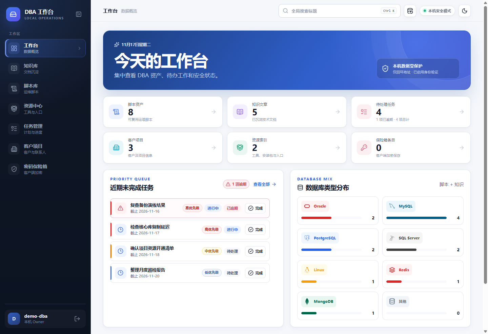

<div align="center">


# DBA 工作台

在一处查找运维脚本、排障文档和客户项目，随时查看待办进度。

面向数据库工程师的 Windows 本机工作台，使用 SQLite 保存数据。

[下载安装](https://github.com/Rainues412/dba-workbench/releases/latest) · [功能概览](#功能概览) · [源码运行](#从源码运行) · [更新日志](CHANGELOG.md) · [问题反馈](https://github.com/Rainues412/dba-workbench/issues)

[](https://github.com/Rainues412/dba-workbench/releases/latest)
[](#安装与启动)

</div>

## 界面预览

以下截图来自 DBA 工作台，使用演示数据。



<details>
<summary>查看客户项目界面</summary>


</details>

## 功能概览

| 模块 | 可以做什么 |
| --- | --- |
| 知识库、脚本库 | 按数据库和分类整理资料，预览 PDF、Office、Markdown 与脚本文本。宽屏支持拖拽分栏，Markdown 支持按目录跳转。 |
| 资源中心 | 集中管理安装包、工具和常用链接，支持从已授权的目录批量导入。 |
| 任务管理 | 设置截止日期和优先级，在工作台查看逾期与待办。已完成任务满 15 天后归档，可按需恢复。 |
| 客户项目 | 按客户展开项目，查看群聊及平台、负责人和职责标签。支持按客户名或项目名搜索，并在项目行直接编辑。 |
| 密码保险箱 | 在浏览器端加密凭据，可使用主密码解锁，忘记主密码时可通过本机恢复密钥重置。 |

## 安装与启动

1. 从 [GitHub Releases](https://github.com/Rainues412/dba-workbench/releases/latest) 下载 `DBA-Workbench-Setup-<版本>-x64.exe` 及同名 `.sha256` 文件。用 PowerShell 的 `Get-FileHash -Algorithm SHA256` 核对安装包。
2. 在 Windows 10/11 x64 上双击 EXE 安装，安装包内置运行时和文件查看器。安装包未签名，Windows 可能提示发布者未知。
3. 启动后，工作台会在浏览器打开 `http://127.0.0.1:8686/`。首次使用按页面提示创建管理员账号。要停止服务，请在系统托盘右键选择「退出」。

覆盖安装前先退出工作台并备份数据。卸载默认保留应用数据。

## 数据与备份

- 工作台只通过本机地址访问。安装版的数据目录为 `%LOCALAPPDATA%\DBA Workbench\data`，源码运行默认使用 `server`。
- 备份前先从托盘退出工作台，保存 `workspace.db` 和保险箱恢复密钥 `.vault_recovery_private.pem`、`.vault_recovery_public.pem`。恢复私钥应与数据库备份分开保管。
- 换电脑时还需复制原始资料，重新授权所在目录，并更新已变更的文件路径。回退旧版时使用升级前的数据库备份。

## 从源码运行

需要 Windows x64 和 Python 3.12 x64。仓库包含生产前端，重新构建前端时需要 Node.js 22.12+（推荐 24.x）。

```powershell
git clone --recurse-submodules https://github.com/Rainues412/dba-workbench.git
Set-Location dba-workbench
py -3.12 -m venv .runtime\.venv
.\.runtime\.venv\Scripts\python.exe -m pip install -r server\requirements.txt
.\.runtime\.venv\Scripts\pythonw.exe tools\windows\launch_dba_workbench.py
```

源码启动器使用系统的 Microsoft Edge WebView2 Runtime，关闭窗口后仍可从系统托盘重新打开。WebView2 不可用时回退到浏览器。从启动器打开时会自动进入工作台。

设置中的「窗口与启动」提供开机启动、静默启动和关闭时最小化到托盘。开机启动在当前 Windows 用户登录后运行；静默启动可独立开启，控制手动启动和登录自启时是否只显示托盘图标，再次打开软件或选择托盘「打开工作台」可显示窗口。关闭开机启动不会改变静默启动设置。「关闭时最小化到托盘」默认开启，关闭后窗口的关闭按钮会退出工作台；浏览器回退模式请从托盘退出。源码版与安装版的启动项分别登记，源码版设置保存在 `.runtime/desktop-settings.json`，安装版保存在数据目录的 `desktop-settings.json`。源码启动器支持 `--show-window` 强制显示窗口。

- 首次创建保险箱时设置主密码和 1–3 道自定义密保问题。已有保险箱使用原主密码解锁后，可补设密保。
- 在「忘记主密码」中答对全部密保问题后，可使用匹配的本机恢复密钥重置主密码。条目仍使用原来的数据密钥。对话框同时提供备份密钥的离线恢复步骤。
- 侧栏底部的「设置」支持界面和代码阅读偏好、导航位置、工作区偏好及快捷键查询。在「密码库安全」中可修改主密码、查看保险箱数据位置、设置闲置锁定时长或主动开启 Windows 本机自动解锁。开启后，启动软件或切换页面再进入保险箱时自动解锁。手动或闲置锁定后，切换页面不会自动解锁，须输入主密码或从托盘彻底退出后重新启动。

如需在源码模式预览 Office、PDF 等文件，可通过 `DBA_FILE_VIEWER_HOME` 指向已构建的查看器目录。[查看器构建脚本](packaging/windows/build-file-viewer.ps1)

#### Tauri 迁移预览

开发验收需要 Windows Rust MSVC 工具链和已安装的前端依赖。先运行 `cargo build --locked --manifest-path src-tauri/Cargo.toml`，再用项目 Python 环境启动预览。

```powershell
.\.runtime\.venv\Scripts\python.exe tools/windows/launch_dba_workbench_tauri.py --executable src-tauri/target/debug/dba-workbench-tauri.exe --work-dir '<现有测试目录>'
```

启动脚本创建独立的测试数据库和 WebView2 配置。仪表盘、任务管理、全局搜索、脚本库、知识库、客户项目、资源中心的记录管理，以及登录状态和保险箱配置读取由 Rust 执行。会话签发、保险箱解锁和恢复、旧数据库升级及本机文件操作沿用现有 FastAPI 服务和权限。页面完成首次渲染后才显示窗口。从托盘选择「退出」结束预览和两个测试服务。

Windows 源码快捷方式可以向 `launch_dba_workbench.py` 传入 `--tauri-host <EXE 路径>`，或在原桌面启动宿主的同一目录放置 `dba-workbench-tauri.exe`。现有数据库、WebView2 配置及启动偏好继续原位使用。

### 测试与构建

```powershell
.\.runtime\.venv\Scripts\python.exe -m pip install -r server\requirements-dev.txt
.\.runtime\.venv\Scripts\python.exe -m pytest

Push-Location frontend
npm ci
npm test -- --run
npm run build
Pop-Location
```

生产前端输出到 `server/frontend_dist`。初始化 Git 子模块后，可运行 `.\packaging\windows\build-installer.ps1 -Version "<major.minor.patch>"` 生成安装包。打包时会重新构建前端，「关于」、程序文件和安装包统一使用此版本号；普通源码构建显示「开发版」。
