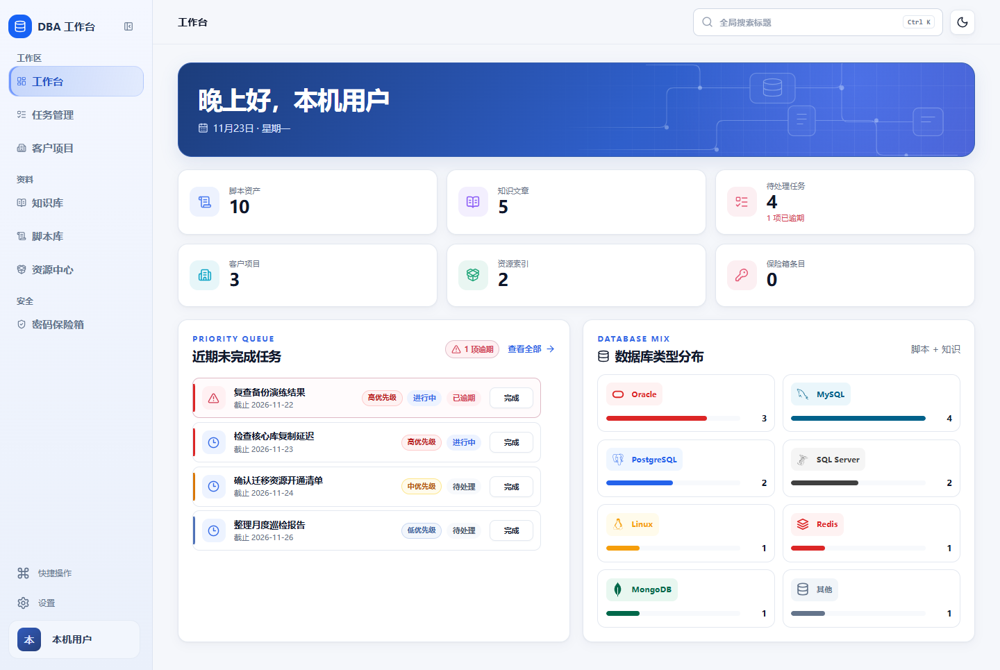
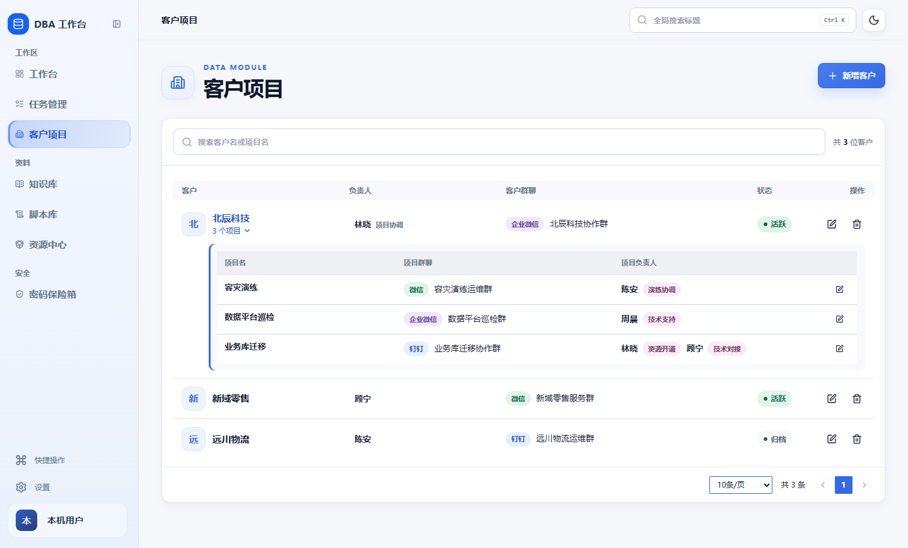

<div align="center">


# DBA 工作台

面向数据库工程师的 Windows 本地工作台，集中管理运维资料、任务、客户项目和凭据。

[下载安装](https://github.com/Rainues412/dba-workbench/releases/latest) · [功能概览](#功能概览) · [从源码运行](#从源码运行) · [问题反馈](https://github.com/Rainues412/dba-workbench/issues)

[](https://github.com/Rainues412/dba-workbench/releases/latest)
[](#安装与使用)

</div>

## 界面预览

工作台总览（演示数据）



<details>
<summary>查看客户项目界面</summary>



</details>

## 功能概览

| 模块 | 可以做什么 |
| --- | --- |
| 脚本库 | 按数据库和用途整理运维脚本，筛选并预览脚本文本。 |
| 知识库 | 整理排障记录和技术文档，预览 PDF、Office 和 Markdown。 |
| 资源中心 | 管理安装包、工具和常用链接，支持从授权目录批量导入。 |
| 任务管理 | 设置优先级和截止日期，跟踪待办、逾期及已归档任务。 |
| 客户项目 | 按客户管理项目、群聊和负责人，支持搜索和行内编辑。 |
| 密码保险箱 | 用主密码解锁加密凭据，支持自动备份、本机恢复和换机导入。 |

## 安装与使用

1. 从 [GitHub Releases](https://github.com/Rainues412/dba-workbench/releases/latest) 下载 Windows 10/11 x64 安装包及 `.sha256` 文件，用 `Get-FileHash -Algorithm SHA256` 校验后安装。
2. 从桌面快捷方式启动。窗口关闭后默认驻留托盘，可从快捷方式或托盘重新打开。停止服务时，在托盘选择「退出」。
3. 首次使用密码保险箱时，按提示设置主密码和密保问题。

安装包未签名，Windows 可能提示发布者未知。覆盖安装前请从托盘退出并备份数据，卸载默认保留数据。安装版功能以对应发布说明为准。

## 数据与隐私

- 工作台仅供本机访问，使用 SQLite 存储数据。安装版数据目录为 `%LOCALAPPDATA%\DBA Workbench\data`，源码版默认为 `server`。
- 备份整个工作台前，请从托盘退出，再复制 `workspace.db`。如已创建保险箱，请同时保管主密码恢复密钥 `.vault_recovery_private.pem` 和 `.vault_recovery_public.pem`，私钥与数据库副本分开放置。

### 密码保险箱备份

从「设置 → 密码库安全 → 备份与恢复」打开备份目录或创建加密备份。源码版备份存于项目根目录下的 `backups`。自动备份默认每 24 小时运行，保留最近 10 份自动备份。

- **本机恢复**时，在备份列表选择「恢复」，验证当前主密码后确认。
- **换机导入**前，先在新电脑设置主密码。选择「导入」，验证主密码后选取旧电脑的 `.age` 备份和对应的 `.key` 恢复密钥。备份和密钥请分开保管。

## 从源码运行

需要 Windows x64 和 Python 3.12 x64。仓库包含生产前端，重新构建前端时需要 Node.js 22.12+（推荐 24.x）。

```powershell
git clone --recurse-submodules https://github.com/Rainues412/dba-workbench.git
Set-Location dba-workbench
py -3.12 -m venv .runtime\.venv
.\.runtime\.venv\Scripts\python.exe -m pip install -r server\requirements.txt
.\.runtime\.venv\Scripts\pythonw.exe tools\windows\launch_dba_workbench.py
```

启动器使用 WebView2，缺少运行时则回退到浏览器。「设置 → 窗口与启动」可调整开机启动、静默启动和关闭时最小化到托盘。

如需在源码模式预览 Office、PDF 等文件，可通过 `DBA_FILE_VIEWER_HOME` 指向已构建的查看器目录。[查看器构建脚本](packaging/windows/build-file-viewer.ps1)

<details>
<summary>Tauri 桌面宿主开发预览</summary>

需要 Windows Rust MSVC 工具链和前端依赖。预览使用独立的数据库和 WebView2 配置。

```powershell
cargo build --locked --manifest-path src-tauri/Cargo.toml
.\.runtime\.venv\Scripts\python.exe tools/windows/launch_dba_workbench_tauri.py --executable src-tauri/target/debug/dba-workbench-tauri.exe --work-dir '<现有测试目录>'
```

</details>

### 测试与构建

```powershell
.\.runtime\.venv\Scripts\python.exe -m pip install -r server\requirements-dev.txt
.\.runtime\.venv\Scripts\python.exe -m pytest

Push-Location frontend
npm ci
npm test -- --run
npm run build
Pop-Location
```

前端构建输出到 `server/frontend_dist`。Windows 安装包使用 [构建脚本](packaging/windows/build-installer.ps1) 生成。

## 反馈与贡献

欢迎提交 Pull Request，或到 [GitHub Issues](https://github.com/Rainues412/dba-workbench/issues) 反馈问题。分享日志和截图前，请移除敏感数据。
